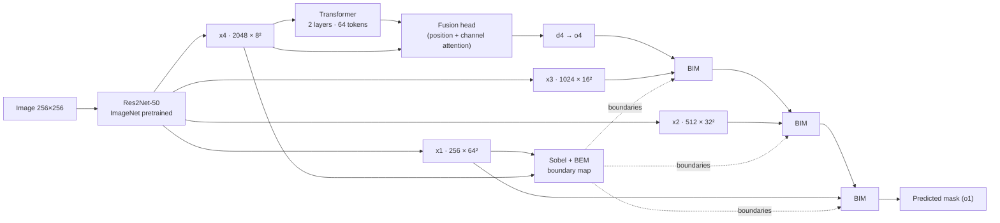
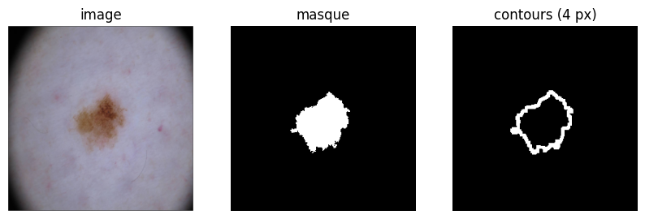
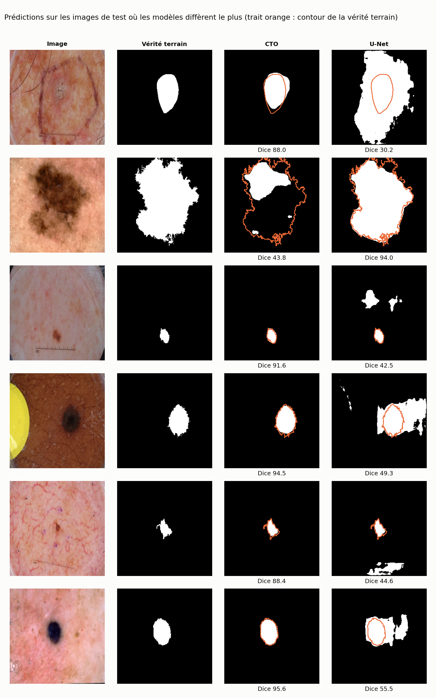

# Medical image segmentation: skin lesion segmentation

A PyTorch implementation of a medical image segmentation network that combines a CNN, a Transformer
and an edge detection operator.

It is inspired by **CTO** (Convolution, Transformer and Operator):

> Y. Lin, D. Zhang, X. Fang, Y. Chen, K.-T. Cheng, H. Chen.
> *Rethinking boundary detection in deep learning-based medical image segmentation.*
> Medical Image Analysis 103 (2025) 103615. Official code: https://github.com/xiaofang007/CTO

The model is trained and evaluated on **ISIC 2018** (task 1, lesion segmentation in dermoscopy),
and its generalization is tested on **PH2** without retraining.

## Model architecture

The network follows the encoder-decoder design of the paper:

1. **CNN encoder.** A Res2Net-50 pretrained on ImageNet produces four feature maps, `x1` to `x4`,
   increasingly small and abstract.
2. **Long-range module.** A standard Transformer (2 layers, attention between the 64 positions of `x4`)
   captures global dependencies. Its output is concatenated with `x4` and passed through a dual-attention
   fusion head, which starts the decoder.
3. **Boundaries (BEM).** A fixed Sobel filter is applied to `x1` (fine details) and `x4` (semantics).
   The two levels are fused to predict a boundary map, supervised by the ground-truth boundaries.
4. **Decoder (BIM).** Three boundary-injection modules go up from `x3` to `x1`. Each one combines
   the encoder features, the boundary map and the previous level's prediction along two paths:
   one enhances boundaries, the other focuses on pixels where the previous prediction is **uncertain**.
5. **Loss.** Sum over the 4 outputs of (cross-entropy + IoU), plus 3 × Dice on the boundary map.

### Differences from the paper and the official code

| | Paper / official code | This repository |
|---|---|---|
| Long-range module | StitchViT on `x1` | standard Transformer on `x4` |
| Second BIM path | background attention, `1 - σ(F)` on the previous decoder features | uncertainty attention, `1 - \|2p - 1\|` on the previous prediction |
| Boundary loss | zero gradient in the official code (softmax over a single channel) | Dice correctly applied to the logits |
| Sobel | sum over channels, no epsilon | per channel, epsilon |
| Ground-truth boundaries | 2 px ring outside the mask | 4 px ring across the boundary |
| Backbone | Res2Net-50 v1b | `timm` Res2Net-50 (`--backbone res2net50d` for the v1b-style variant) |

Most differences are options (`python train.py --help`): `--bim-attention background`,
`--edge-mode outside --edge-width 2` and `--backbone res2net50d` bring the model closer to the paper.
The StitchViT itself is not implemented.

## Data

An ISIC 2018 example, with its mask and the boundaries used to supervise the boundary branch:

The 2594 ISIC 2018 images are resized to 256×256 and split as in the paper (fold 0):
1661 for training, 415 for validation and 518 for testing.

## Results

### Comparison with U-Net

Predictions on the test images where the two models differ most (orange line: ground-truth boundary):

### Comparison on ISIC 2018

| Method | Backbone | Dice (%) | IoU (%) | Params (M) | Source |
|---|---|---|---|---|---|
| MedSAM | ViT-B16 | 83.5 | 77.4 | – | paper |
| MedT | ViT-B16 | 85.9 | 77.8 | – | paper |
| U-Net++ | VGG-16 | 87.9 | 80.5 | – | paper |
| DeepLabv3 | ResNet-50 | 88.4 | 80.6 | – | paper |
| CE-Net | ResNet-34 | 89.1 | 81.6 | – | paper |
| TransUNet | ResNet-50 | 89.4 | 82.2 | – | paper |
| CTO (paper) | Res2Net-50 + StitchViT | 90.6 | 84.0 | 62.2 | paper |
| **U-Net (this repo)** | – | **87.11** | **80.97** | 7.76 | this repo |
| **CTO (this repo)** | Res2Net-50 + Transformer | **90.31** | **83.15** | 59.19 | this repo |

Paper figures are averages over 5 folds. This repository's figures come from a single fold (518 test images),
with a batch size of 16 instead of 32, so differences of a few tenths of a point are not significant.
CTO costs 15.36 GFLOPs and U-Net 13.75 GFLOPs for a 256×256 image.

### Generalization to PH2

The two models trained on ISIC 2018 are evaluated as is on the 200 images of PH2
(another hospital, another dermoscope), without retraining or fine-tuning:

| Model | Dice ISIC 2018 (%) | Dice PH2 (%) | Gap (points) | IoU ISIC 2018 (%) | IoU PH2 (%) |
|---|---|---|---|---|---|
| U-Net | 87.11 | 88.37 | +1.26 | 80.97 | 82.15 |
| **CTO** | **90.31** | **90.76** | **+0.45** | **83.15** | **84.19** |

Neither model loses accuracy on the new dataset, and CTO stays ahead of U-Net (+0.8 Dice points).
The scores are even slightly higher on PH2, which is expected: its lesions are larger, well centered and
acquired under uniform conditions, so PH2 is an easier dataset than ISIC 2018. The gap therefore shows
that the models do not overfit ISIC 2018, not that they perform better on new data.

